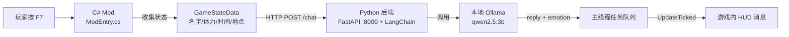

# 星露谷 AI 陪玩 Mod（Stardew AI Companion）

一个由 **SMAPI Mod（C#）+ 本地 Python AI 后端（FastAPI + LangChain）** 组成的星露谷物语 AI 陪伴系统。

按下 **F7** 呼叫你的 AI 伴侣，它会实时读取你的游戏状态（名字、体力、时间、地点）并给出回应。

> **最终目标**：让一个漂浮在玩家身旁的小机器人陪伴你冒险——它感知玩家状态机，结合游戏知识库（RAG）进行多轮智能对话。

---

## 当前版本状态（v0.2 · 接入本地 LLM）

- ✅ C# Mod：F7 按键 → 收集玩家状态 → 异步请求后端 → HUD 显示回复
- ✅ Python 后端：`POST /chat` 接收状态，通过 **LangChain 调用本地 Ollama 模型**（`qwen2.5:3b`）生成回复
- ✅ 游戏内可看到 AI 结合实时玩家状态生成的回答
- ⚠️ `emotion` 字段仍固定为 `happy`，尚未接表情/立绘

## 架构



**关键设计**：
- `await` 之后的代码运行在线程池后台线程，所有 HUD 操作通过主线程任务队列（`Queue<Action>` + `UpdateTicked`）调度回游戏主线程执行，避免随机崩溃
- 全局复用单个 `HttpClient`，15 秒超时，请求期间游戏照常运行不卡顿
- 后端将游戏状态拼装为提示词注入 LLM，System Prompt 约束角色设定（亲切简短、1-2 句话、禁止编造游戏信息）
- 未进入存档时按 F7 会友好提示，不会崩溃

## 目录结构

```
AI_Projects/
├── AIpy/                      # Python AI 后端
│   ├── main.py                # 入口：FastAPI 应用，POST /chat
│   └── pyproject.toml         # uv 依赖管理（fastapi / pydantic / uvicorn）
├── stardewAI/                 # C# SMAPI Mod
│   ├── ModTemplate/
│   │   ├── ModEntry.cs        # Mod 入口：F7 流程、线程队列、HTTP 请求
│   │   ├── manifest.json      # SMAPI 清单（UniqueID: yz.StardewAIAssistant）
│   │   └── StardewAIAssistant.csproj
│   └── NOTES.md               # 开发笔记（踩坑记录，值得一看）
└── .gitignore
```

## 环境要求

| 组件 | 版本要求 |
|---|---|
| 星露谷物语 | 1.6.15（Steam 版） |
| SMAPI | 4.x（MinimumApiVersion 4.0.0） |
| .NET SDK | 6.0（编译 Mod） |
| Python | ≥ 3.11，使用 [uv](https://docs.astral.sh/uv/) 管理依赖 |
| [Ollama](https://ollama.com/) | 本地推理服务，模型 `qwen2.5:3b`（默认端口 11434） |

## 快速开始

### 1. 准备本地 Ollama

安装 [Ollama](https://ollama.com/download) 并拉取模型（首次需联网下载）：

```bash
ollama pull qwen2.5:3b
```

Ollama 安装后一般会自动在后台运行（默认端口 `11434`）；若没有，手动执行 `ollama serve`。

### 2. 启动 AI 后端

```bash
cd AIpy
uv sync                                  # 首次安装依赖（含 langchain / langchain-ollama）
uv run uvicorn main:app --port 8000      # 启动服务（调试可加 --reload）
```

### 3. 编译并部署 Mod

```bash
cd stardewAI/ModTemplate
dotnet build
```

- 编译前请修改 [StardewAIAssistant.csproj](stardewAI/ModTemplate/StardewAIAssistant.csproj) 中的 `GamePath` 为你的游戏安装路径
- build 成功后 DLL 会**自动复制**到 `Mods/StardewAIAssistant` 目录
- ⚠️ 游戏/SMAPI 开着时 build 会因 DLL 被占用而失败，请先关闭游戏
- 只想验证语法、不部署：`dotnet build -p:EnableModDeploy=false -p:EnableModZip=false`

### 4. 开始对话

1. 启动 SMAPI 进入游戏
2. 读取存档（主菜单中按 F7 只会得到提示）
3. 按 **F7**，左上角 HUD 会先显示「AI伴侣正在思考中...」，随后显示回复
4. SMAPI 控制台可查看状态收集与后端返回的详细日志

## 通信协议（C# ⇄ Python）

`POST http://127.0.0.1:8000/chat`

**请求**（PascalCase，与 C# `System.Text.Json` 默认序列化对齐）：

```json
{ "PlayerName": "农夫", "Stamina": 87.5, "GameTime": 1330, "Location": "Farm" }
```

**响应**（小写键名，C# 端通过 `PropertyNameCaseInsensitive` 映射）：

```json
{ "reply": "你好呀 农夫！...", "emotion": "happy" }
```

注意事项：
- `GameTime` 为游戏内时间，`600` 表示早上 6:00
- 请求字段名是**故意**用 PascalCase 对齐 C# 输出的，修改字段时两端必须同步修改

## Roadmap

- [x] 接入真实 LLM：本地 Ollama + LangChain（`qwen2.5:3b`）
- [ ] 模型与参数可配置化（当前写死 `qwen2.5:3b`、`temperature=0.7`）
- [ ] 漂浮机器人：贴图渲染、跟随玩家移动、待机动画
- [ ] 防连点：思考中再按 F7 忽略或排队
- [ ] 扩充状态感知：季节、天气、金币、背包、NPC 好感、当日任务
- [ ] 多轮对话记忆（当前每请求独立）
- [ ] RAG 知识库：游戏知识 + 玩家档案检索
- [ ] F7 改键写入 config.json，避免与其他 Mod 冲突
- [ ] `emotion` 字段驱动机器人表情 / 立绘变化

## 常见问题

| 现象 | 原因与解决 |
|---|---|
| HUD 提示「AI大脑连接失败」 | Python 后端未启动或端口不是 8000，先启动后端 |
| 后端日志报 Ollama 连接错误 | Ollama 服务未运行（默认端口 11434），执行 `ollama serve` |
| 按 F7 后回复很慢 | 首次调用需把模型加载进内存/显存，属正常现象；可先 `ollama run qwen2.5:3b` 预热，推理速度取决于本地硬件 |
| HUD 提示「响应超时」 | 后端卡住超过 15 秒，检查后端控制台日志 |
| `dotnet build` 报 `UnauthorizedAccessException` | 游戏/SMAPI 正在运行占用 DLL，先关闭游戏 |
| 游戏内 HUD 文字无法自定义颜色 | 游戏本体 1.6.15 移除了 `HUDMessage.color`，错误提示改用 `error_type` 图标 |

更多踩坑细节（反射查 API、沙箱限制、C# 与 C++ 差异等）见 [stardewAI/NOTES.md](stardewAI/NOTES.md)。

## 许可证

待定（TBD）
